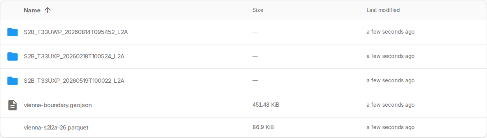
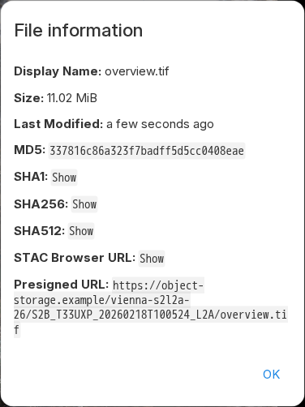
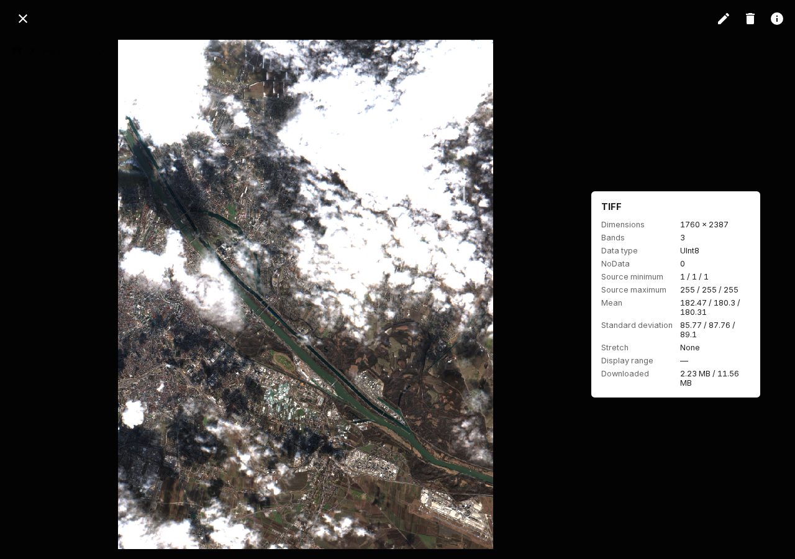
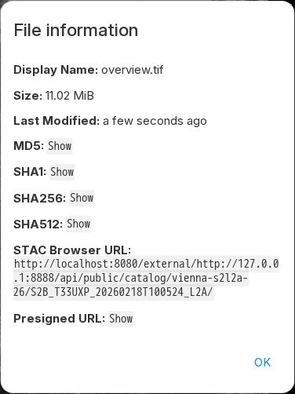
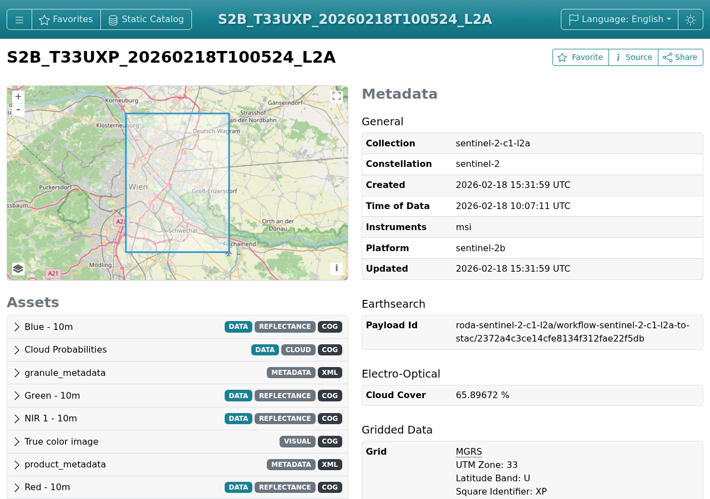

# Package, share, and preview data

packageR publishes an object prefix as a browser package. Recipients do not
need an account. Operators define packages before startup. Users can open the
links in the web interface, but cannot change them.

## Package an object prefix

Run the share command before startup, after you create the database and owner
account. These examples use the owner `admin` with scope `/` and one bucket
in `PACKAGE_R_ROOT`. The share path is relative to that scope:

```bash
./package-r shares add admin public /deliverables/26-06 \
  --description="June 2026 deliverables" \
  --expiration=30d
./package-r shares add admin report /reports/report.tif
```

On a server at `https://packages.example.org`, these links are
`https://packages.example.org/share/public/` and
`https://packages.example.org/share/report/`.

A prefix package lets a public visitor navigate below the configured path. A
single-object package opens that object. The visitor cannot navigate above the
configured path.

The package name is part of its URL. It must contain 1 to 20 lowercase letters,
digits, dots, or hyphens.

Use `--description` to add a short label. Signed-in users see it with the
share link in **Settings**.

Use `--expiration` to set the share lifetime. Use a positive number with days
(`d`), calendar months (`m`), hours (`H`), or calendar years (`y`). For
example, use `10d`, `2m`, `3H`, or `2y`. Leave it empty to create a share
without an expiration.

A hard-to-guess name can reduce accidental discovery, but it is not an access
control. Add a share password when recipients must authenticate before they
open the package.



## Protect a package with a share password

Pass the password when you add the share:

```bash
./package-r shares add admin report /reports/report.tif \
  --password=my-password
```

The browser asks for the password before it opens the package. API clients send
it in `X-SHARE-PASSWORD`. Read passwords from a deployment secret and do not
write them to logs.

## Use a direct object URL

Authenticated files and public shares use the same browser interface. Public
shares are read-only and do not show upload, change, delete, download, or
directory archive actions.

To download a file, select **Info**, then **Show** next to **Presigned URL**.
Open the displayed link to read the file directly from S3. Supported viewers
also use presigned URLs for previews.



The API can also return a `307 Temporary Redirect` to the direct URL. See the
[HTTP API](../reference-guides/http-api.md#public-shares).

## Preview a COG

Open a TIFF or GeoTIFF object from the file list or public share. The viewer
uses the presigned URL and byte-range requests to load the required image
parts.

If the viewer does not load, ask the operator to check
[object-storage CORS and range requests](configuration.md#browser-access).



## Publish a STAC-compatible Parquet catalog

The `vienna-s2l2a-26` example contains three Sentinel-2 Collection 1 Level-2A
scenes from [Earth Search by Element 84](https://earth-search.aws.element84.com/v1/),
clipped to Vienna. Its catalog follows the
[STAC GeoParquet specification](https://github.com/radiantearth/stac-geoparquet-spec/blob/main/stac-geoparquet-spec.md).

Place the Parquet catalog inside the shared directory. Each row needs `id`,
STAC time data, and an `assets` JSON object with `href` values. The
[HTTP API](../reference-guides/http-api.md#public-catalogs) lists all supported
fields and limits.

Use relative asset paths when possible. packageR also resolves root-relative,
HTTP(S), and `s3://` paths that identify an object inside the share. External
URLs stay unchanged. See [ADR-002](../architecture/0002-publish-parquet-catalogs-as-stac.md)
for the matching rules.

Set the relative catalog path when you add the share:

```bash
./package-r shares add admin vienna-s2l2a-26 /vienna-s2l2a-26 \
  --catalog-name=vienna-s2l2a-26.parquet
```

Use `--asset-mappings` only when asset URLs do not match paths inside the
share. [ADR-002](../architecture/0002-publish-parquet-catalogs-as-stac.md#decision)
shows the JSON format and a mapping example.

If `--catalog-name` is empty or omitted, the share has no catalog endpoint.

For the Vienna share, request the STAC Collection:

```text
/api/public/catalog/vienna-s2l2a-26
```

Add a path below the share to select matching catalog entries:

```text
/api/public/catalog/vienna-s2l2a-26/S2B_T33UXP_20260218T100524_L2A/
```

Use the absolute endpoint URL in a STAC Browser. Operators can
[configure STAC Browser links](configuration.md#catalogs) in packageR.
Use HTTPS for both services in a hosted deployment to avoid
[mixed-content errors](https://developer.mozilla.org/en-US/docs/Web/Security/Defenses/Mixed_content).

Open the public share and select **Info** to get the Collection preview link.
Open an acquisition directory and select **Info** to get its Item preview link.
For a file, the link appears above the presigned object URL. In each case,
select **Show** next to **STAC Browser URL**.



Open the link to inspect the Item, its Vienna footprint, metadata, and assets in
the configured STAC Browser.


