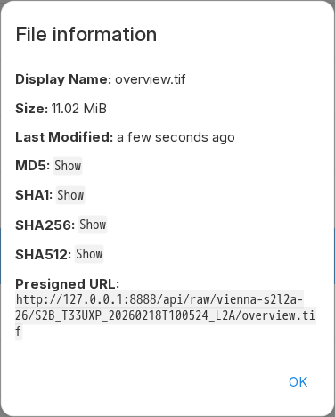

# Work with objects

This guide covers common browser tasks. Available buttons depend on your
permissions.

## Sign in

Use the account supplied by your operator. Some deployments use single
sign-on through a reverse proxy.

## Browse storage

The first page lists buckets or the contents of one bucket, depending on the
deployment. Use the directory list or breadcrumb path to navigate.

## Inspect and download an object

Open a file to use its viewer. Use **Info** to see its name, size,
modification time, type, checksums, and presigned URL when available.

Select **Show** next to **Presigned URL** to display the link. Open the link
to read the object directly from storage. The URL is valid for at most seven
days. Anyone with the URL can read the object until it expires. Do not put it
in logs or source code.

## Upload data

Use **Upload** to select files or folders. You can also drag files into the
file list. The browser uses resumable uploads for large files.

An upload first uses the local rclone cache. It is complete after rclone writes
the object to S3. Contact the operator if the cache is full or not writable.

## Manage objects

Select an item to use these actions:

- **Rename** changes its name in the same directory
- **Copy** creates a copy at the selected destination
- **Move** moves it to the selected destination
- **Delete** removes it
- **New folder** creates a directory marker when the object store needs one

S3 does not have a filesystem rename operation. A rename or move can copy the
data and then delete the source. Large operations can take time and add
storage request costs.

If an action is not available, ask the operator to check your permissions.
A `403 Forbidden` response can also come from the storage policy.

## Supported previews

The built-in viewers support common text, image, audio, and video formats.
packageR also previews TIFF, GeoTIFF, and COG files. It does not provide a
general Parquet table viewer or a Zarr viewer.

See [Share and preview data](share-and-preview-data.md) to use configured
public shares, direct object URLs, and STAC catalog responses.
