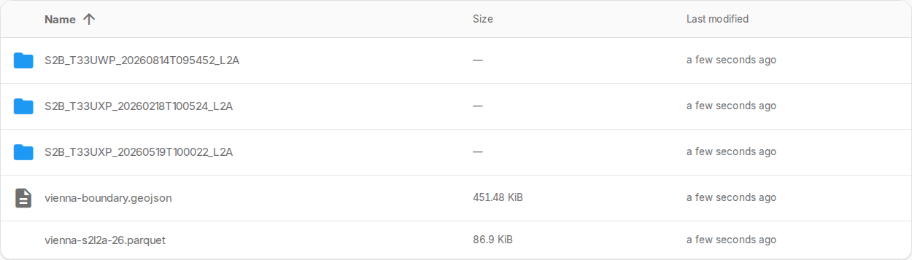

# packageR

Use packageR to share files and folders from S3-compatible storage. Recipients
open a share link in their browser and browse the files without an account.
You can protect each share with a password.

The web interface also lets signed-in users browse and manage objects. A
Parquet catalog inside a package can provide public [SpatioTemporal Asset
Catalog (STAC)](https://stacspec.org/) JSON.

packageR previews JSON, Markdown, PDF, common image formats, and cloud-native
formats such as Cloud Optimized GeoTIFF (COG).

packageR connects to object storage directly:

```text
Object operations: Browser -> packageR API -> rclone VFS -> object storage
Previews and downloads: Browser -> object storage (presigned URL)
```

All users access storage through one S3 identity. Its storage policy controls
which buckets and objects packageR can access. User scopes, path rules, and
permissions further limit what each user can do. See
[Configuration](how-to-guides/configuration.md) for the full access model.

## Choose a guide

- **New users:** [Work with objects](how-to-guides/work-with-objects.md)
- **Data publishers:**
  [Package, share, and preview data](how-to-guides/share-and-preview-data.md)
- **Operators:** [Configuration](how-to-guides/configuration.md) and
  [Kubernetes](how-to-guides/kubernetes.md)
- **API clients:** [HTTP API](reference-guides/http-api.md)


